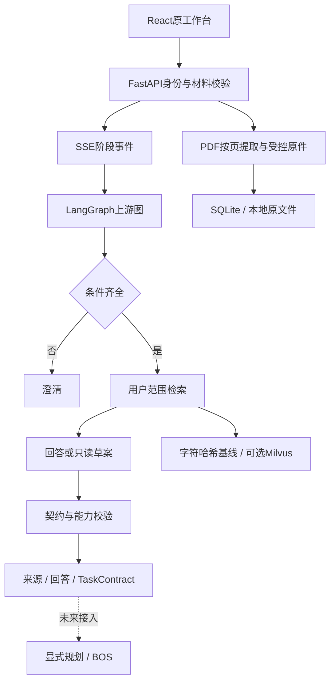

# 序流 v0.3 系统架构

以同目录 `系统架构图.html` 为可搜索图文入口，`symbols.json` 为本轮按 AST 提取的源码类/函数与行号。`系统架构图.svg` 可放入汇报。主链路为：

关键接口：`POST /api/documents/pdf`、`GET /api/documents/{asset_id}/original`、`POST /api/upstream/stream`、`GET /api/upstream/sessions`。`schemas.py`定义结构，`graph.py`组织7个节点，`service.py`维护逐请求检查点、会话摘要和事件，`validators.py`校验已知能力与未执行权限。

当前上游不会调用 `agent/executor.py:Executor`。保留原 `Planner/Executor` 作为后续研究对照基座。外部服务配置只是可选适配，不作为本轮端到端服务实测。
