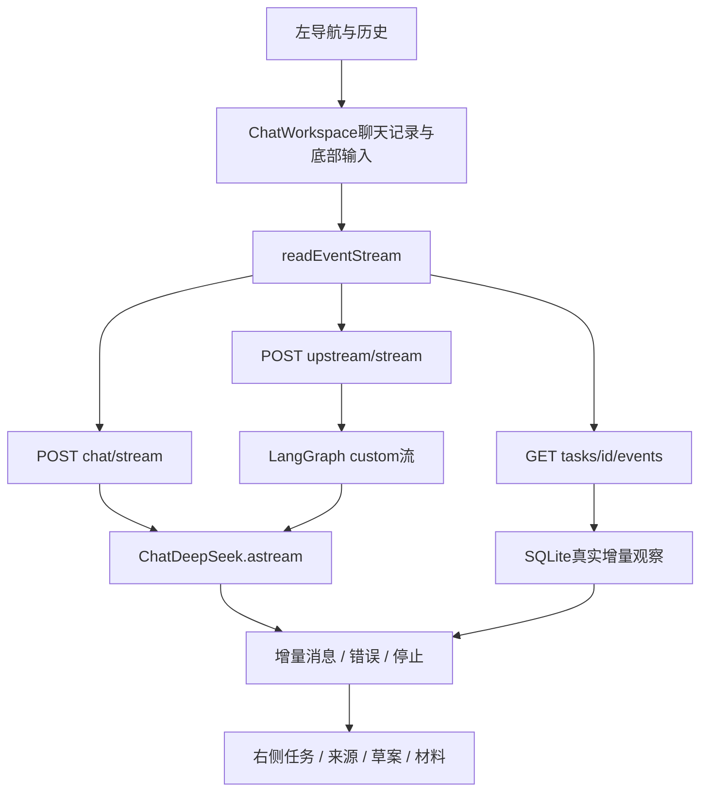

# 序流 v0.4 流式聊天架构

可搜索HTML、SVG与symbols.json均在同目录；行号来自本轮源码。关键新增文件：ChatWorkspace.tsx、components/chat.css、sse.ts、backend/app/streaming.py。原app/main.py注册流式路由；llm.py新增stream_completion；upstream.graph与service转发custom流；tools/power.py改为流式报告正文。

普通对话异常不产生成功done。停止中断生成器；完整回答正常完成才写assistant历史。工具正文只是流式预览，正式报告校验后替换。草案仍未执行。旧PDF来源和用户隔离逻辑保留，未新增BOS或任意写操作。
