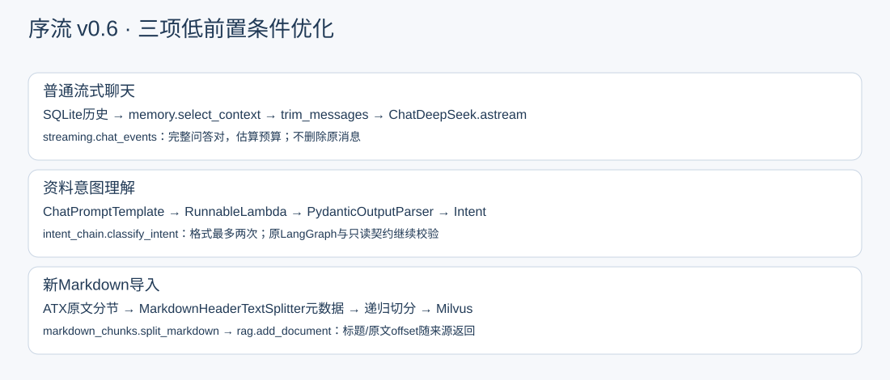

# A4G v0.6源码架构

- `src/backend/app/memory.py:8` `estimate`
- `src/backend/app/memory.py:11` `select_context`
- `src/backend/app/markdown_chunks.py:7` `split_markdown`
- `src/backend/app/streaming.py:18` `encode`
- `src/backend/app/streaming.py:20` `chat_events`
- `src/backend/app/streaming.py:60` `build_stream_router`
- `src/backend/app/rag.py:24` `embed`
- `src/backend/app/rag.py:39` `chunk`
- `src/backend/app/rag.py:41` `_documents`
- `src/backend/app/rag.py:53` `publish_knowledge`
- `src/backend/app/rag.py:76` `add_document`
- `src/backend/app/rag.py:96` `vector_store_label`
- `src/backend/app/rag.py:99` `search`
- `src/backend/app/upstream/intent_chain.py:10` `classify_intent`
- `src/backend/app/upstream/graph.py:11` `parse_intent`
- `src/backend/app/upstream/graph.py:29` `confirm_entities`
- `src/backend/app/upstream/graph.py:38` `collect_missing_fields`
- `src/backend/app/upstream/graph.py:50` `retrieve_evidence`
- `src/backend/app/upstream/graph.py:57` `clarify`
- `src/backend/app/upstream/graph.py:60` `compose_response`
- `src/backend/app/upstream/graph.py:82` `finalize_contract`
- `src/backend/app/upstream/graph.py:93` `build_upstream_graph`

职责和调用逻辑见同目录可搜索HTML、操作手册。