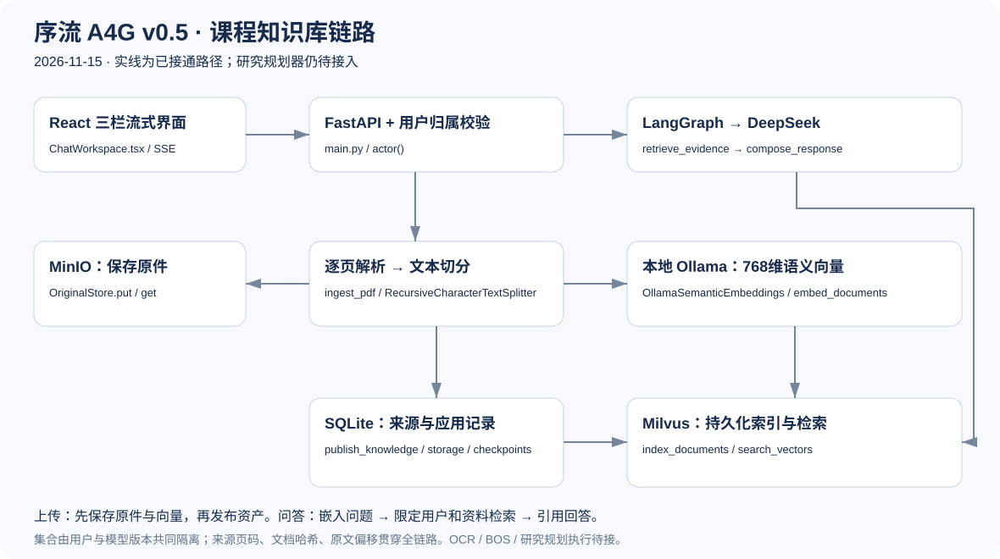

# 源码架构 · A4G v0.5

| 源码 | 类/函数 | 职责与调用 |
|---|---|---|
| documents.py | OriginalStore.put/get、ingest_pdf | 保存/读回原件，PDF逐页提取；调用 rag.publish_knowledge |
| embeddings.py | OllamaSemanticEmbeddings、get_embeddings、embedding_info | 获取模型修订，校验数量/维度/有限数值，返回归一化向量与版本指纹 |
| rag.py | publish_knowledge、add_document、_documents、search | 切分/来源元数据；先pending，入库成功改ready；检索按SQL归属限定资料 |
| repositories/milvus.py | collection_name、index_documents、search_vectors、delete_documents | 用户+模型分集合，固定chunk主键批量upsert；按授权document_id检索；异常补偿 |
| course_status.py | inspect_stack | 实际探测模型、MinIO和Milvus；不暴露凭据 |
| main.py | upload、upload_pdf、original_pdf、knowledge_status、configuration | HTTP接口、身份校验、受控原件下载、异步线程调用 |
| upstream/graph.py | retrieve_evidence、compose_response、build_upstream_graph | LangGraph检索调用rag.search，随后DeepSeek正文真实流式输出 |
| upstream/service.py | upstream_events | 图检查点、阶段事件与正文事件转SSE |
| scripts/migrate_course_knowledge.py | migrate | 逐资料写MinIO与向量，成功更新元数据，保留ID与本地原件 |
| scripts/course_stack.py / run.py | 命令入口 / --course | 生成私密课程配置、启停独立Compose、加载课程配置 |

上表 backend 路径均位于 `src/backend/app/`，实际工作目录 `/Users/zz/Desktop/A4G`。CSV数值分析与研究规划接口未更换。语义索引不在每次查询时重嵌文档；模型指纹变化需显式迁移。SQLite是授权和来源的最终依据，Milvus中的孤立向量不可越过授权返回。
